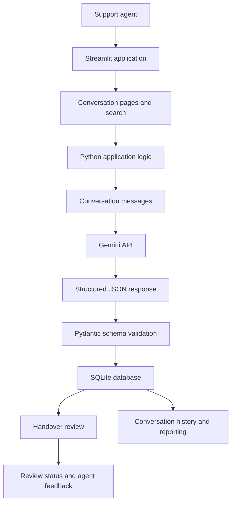

# Learner Support AI

**Live application:** https://sandeep-learner-support-ai.streamlit.app/  
**GitHub repository:** https://github.com/sy28595-collab/Learner-Support-AI  
**Demo video:** Coming soon

---

## About the project

When a learner contacts a support team several times, the next agent may have to read a long conversation before they can understand what has happened. That takes time, and important details can be easy to miss.

I built Learner Support AI to make that handover easier. A support agent can open a conversation, generate a structured summary with Google Gemini, review it, and keep the summary with the conversation record.

The summary focuses on five things: the learner's main issue, steps already tried, the current status, unanswered questions, and the next action.

## How it works

1. The application starts and initializes its SQLite database.
2. If the conversation table is empty, the sample conversation data is imported.
3. A support agent selects a conversation or searches for one.
4. The conversation messages are sent to the Gemini API with instructions to produce a concise handover summary.
5. Gemini returns structured JSON. Pydantic validates the response against the summary schema.
6. The application saves the summary, including its version and provider/model details.
7. An agent can review the summary, update its review status, and provide feedback.

The generated summary is intended to help the next agent get up to speed. It does not replace the original conversation or the agent's judgement.

## System architecture



The main parts have separate responsibilities:

- **Streamlit** provides the pages and controls used by the support agent.
- **Python modules** handle conversation retrieval, summary generation, saving, searching, and audit actions.
- **Google Gemini** creates the handover summary from the supplied messages.
- **Pydantic** checks that the response contains the expected fields and data types.
- **SQLite** stores learners, threads, messages, issue tags, summaries, feedback, and audit records.

## What is included

- Dashboard with conversation and summary information.
- Conversation search using a thread ID, learner ID, or message text.
- Filters for conversation status and issue type, with pagination.
- Conversation view and AI handover summary generation.
- Summary review with pending, approved, and rejected statuses.
- Summary version history.
- Agent feedback on summaries.
- Audit log records for tracked actions.
- Conversation history, analytics, and export pages.
- A page for adding a new conversation.

## Summary format

Each generated handover summary contains:

| Field | What it records |
| --- | --- |
| Main issue | The learner's primary problem |
| Steps tried | Troubleshooting or actions already taken |
| Current status | The latest known state of the issue |
| Unresolved questions | Details that still need an answer |
| Next action | A suggested follow-up for the support agent |

The generation instructions tell Gemini to use only details found in the conversation, avoid inventing facts, and make missing information clear.

## Database

The application uses SQLite. The database schema currently defines these tables:

| Table | Purpose |
| --- | --- |
| `learners` | Learner records |
| `support_threads` | Conversation/thread details and status |
| `support_messages` | Individual learner and agent messages |
| `issue_tags` | Issue types and extracted entity information |
| `handover_summaries` | Generated summaries, versions, provider/model details, and review status |
| `agent_feedback` | Ratings, written feedback, and corrected summaries |
| `audit_logs` | Records of actions performed in the application |

The database schema is in `database/schema.sql`. The application creates or initializes the database through `database/db.py`.

## Project structure

```text
Learner-Support-AI/
│
├── app.py
├── requirements.txt
├── .env.example
├── .gitignore
│
├── .streamlit/
├── data/
│   └── raw/
│
├── database/
│   ├── db.py
│   ├── schema.sql
│   ├── crud.py
│   ├── import_data.py
│   ├── summary_manager.py
│   └── audit_manager.py
│
├── models/
│   └── schemas.py
│
├── prompts/
├── src/
│   ├── gemini_client.py
│   └── search.py
│
├── ui_pages/
│   ├── dashboard.py
│   ├── summarizer.py
│   ├── review.py
│   ├── history.py
│   ├── analytics.py
│   ├── export.py
│   └── new_conversation.py
│
└── tests/
```

The folders are kept separate so that the page code, database operations, AI integration, and data validation are easier to work on independently.

## Technology used

| Area | Technology |
| --- | --- |
| Language | Python |
| User interface | Streamlit |
| Generative AI | Google Gemini API (`google-genai`) |
| Data validation | Pydantic |
| Database | SQLite |
| Data handling | Pandas |
| NLP utilities | NLTK |
| Charts | Plotly |
| Environment variables | python-dotenv |

## Run it locally

These steps are for Windows PowerShell.

### 1. Clone the repository

```powershell
git clone https://github.com/sy28595-collab/Learner-Support-AI.git
cd Learner-Support-AI
```

### 2. Create and activate a virtual environment

```powershell
python -m venv .venv
.venv\Scripts\Activate.ps1
```

### 3. Install the dependencies

```powershell
pip install -r requirements.txt
```

### 4. Add the Gemini API key

Create a `.env` file in the project root. You can use `.env.example` as a reference:

```env
GEMINI_API_KEY=your_gemini_api_key_here
GEMINI_MODEL=gemini-3.6-flash
```

Replace the placeholder with your own API key. Do not commit the `.env` file or share the key publicly. For Streamlit Community Cloud, add the same settings through the app's Secrets configuration.

### 5. Start the application

```powershell
streamlit run app.py
```

Streamlit will print a local address in the terminal. Open that address in your browser.

## Deployment

The hosted version is available here:

https://sandeep-learner-support-ai.streamlit.app/

The app is configured to use Streamlit Community Cloud. The Gemini API key must be provided through Streamlit Secrets for the hosted application.

## Demo

A short walkthrough video will be added here after it has been recorded and uploaded.

**Demo video:** Coming soon

---

Built by **Sandeep Yadav**.
